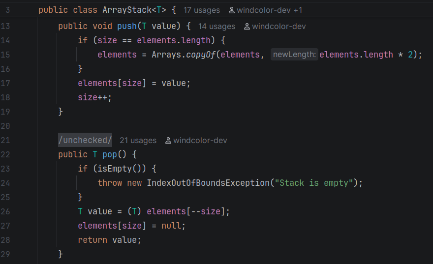
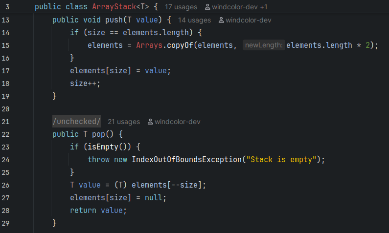

# Darkest Dark Theme for IntelliJ (Best UI)

  
  

Comparison

The "Darkest Dark" theme for the Eclipse IDE by Genuitec is the best color scheme I've ever used! Unfortunately, the extension no longer runs and appears unmaintained. It also does not exist on IntelliJ. 

This simple plugin ports the color theme over to IntelliJ

> (This is an unofficial remake)

## Install

1. Download the JAR from releases
2. In IntelliJ, open **Settings → Plugins → ⚙ → Install Plugin from Disk…** and pick the JAR
3. Restart IntelliJ
4. Choose **"Darkest Dark"** under **Settings → Appearance & Behavior → Appearance → Theme**.
